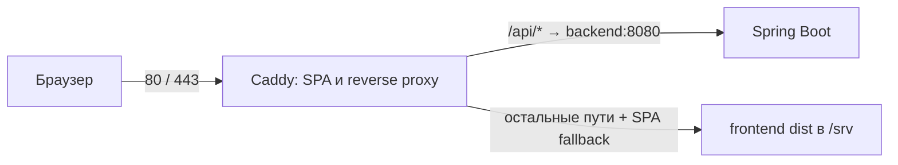

# Relationer — текущая архитектура

Состояние 11 ноября 2026: единый каталог MVP и локальное ревью графов.
День 12 остаётся открытым. Развёртывание на публичном хостинге не подтверждено.
План — в [roadmap](../roadmap.md).

## Компоненты и поток данных

```mermaid
flowchart LR
    JSON[reference-catalog: production + draft] --> Loader[ReferenceCatalogLoader]
    Loader --> Catalog[ReferenceCatalog: объединение по ID]
    Catalog --> Read[ReferenceCatalogService]
    Catalog --> Search[ReferenceSearchService]
    Read --> API[REST: metadata / graph / PNG]
    Search --> API
    API --> Client[Generated TypeScript client]
    Client --> Feed[/references: просмотр и ревью]
    Client --> Editor[Конструктор]
    Feed --> Layout[Dagre / Vue Flow]
    Feed --> Local[localStorage / экспорт результатов]
```

Backend: Kotlin 1.9.25, JDK 21, Spring Boot 3.3.12, Gradle 8.10.2.
Frontend: Vue 3, TypeScript, Vite, Vue Flow, Dagre. БД, авторизации, API записи
каталога и внешнего хранилища нет. JSON и изображения входят в bootJar и требуют
перезапуска backend после изменения. Frontend не хранит runtime-копий каталога/PNG.

## Каталог и домен

`backend/src/main/resources/reference-catalog/` содержит references.json (11 рабочих
записей), references-draft.json (94 записи) и images/ (94 PNG). Общие 11 ID идентичны,
в объединении 94 уникальных кейса. Черновики участвуют в ReferenceSearch.

`ReferenceCatalogLoader` — прежний валидатор с чтением старого source/verdict и
нового sources. `ReferenceCatalogEntry` хранит title, статус проверки графа и список
источников отдельно от неизменённого ReferencePattern. У всех импортированных
кейсов DRAFT. REVIEWED подтверждает граф, а не исторический вывод.

Типы связей: BIOLOGICAL, MARRIAGE, SPIRITUAL, ADOPTION. ADOPTED из архива читается
как ADOPTION; направление усыновления сохранено. Категории — множество BLOOD,
AFFINITY, SPIRITUAL, ADOPTION, независимо от Verdict. Теги нормализуются в NFC и
нижний регистр. Нет категорий MIXED и автоматически угаданных видов родства.

PathExtractor, PathEncoder, PathMatcher и ReferenceSearch сохранены. Для прежнего
направления contains в ReferencePattern проецируется вердикт первого источника.
Источники с разными выводами возвращаются отдельно, автоматически не разрешаются.
Повторные ID объединяются только при полном совпадении содержимого; конфликт
версий не выбирается молча. Ошибка чернового файла изолирована: production остаётся
доступен, поиск возвращает предупреждение о неполном каталоге.

## API и интерфейс

`backend/openapi.yaml` — единый wire-контракт. OpenAPI Generator 7.17.0 генерирует
Kotlin в backend/build/generated/openapi и TypeScript в frontend/src/api/generated;
сгенерированные файлы исключены из Git. Перед dev/test/build работает api:generate.

Существующий `/api/v1/references` поддерживает catalog, category, reviewStatus,
search, sort; детали — `/{id}`, PNG — `/{id}/image`, совпадения — POST `/search`.
Первый source/verdict в API сохранён как совместимый алиас sources[0]. Все
источники, title и reviewStatus доступны в списке, деталях и поиске. Исторический
вердикт не представлен как подтверждённое заключение приложения.

ReferencesPage переключает «Рабочие» / «На проверке», фильтрует весь набор
метаданных, подгружает карточки по 10, отменяет запросы при смене каталога и
игнорирует устаревшие ответы. Для ревью загружаются детали и отпечатки черновиков.
Отметки сохраняются локально; API не записывает их в JSON. SHA-256 содержимого
и версии PNG защищают от переноса одобрения на изменённую запись.

ReferenceCard/ReferenceGraph отображают прежние компактные графы 132×52 (конструктор
200×80), A/B, fit, zoom и разворот. PNG сохраняет пропорции, увеличивается в нативном
dialog; у нескольких источников можно выбрать схему. Desktop — две колонки,
mobile — вертикально. Отсутствующий или недоступный файл имеет явное сообщение.

Конструктор хранит граф в памяти, без сохранения в localStorage. Его управление и
алгоритм сопоставления не менялись. Маршрутизатора нет: main.ts выбирает страницу
по pathname, обычные ссылки выполняют переходы. Локальные отметки ревью используют
отдельный localStorage и не затрагивают редактор.

Подробный [формат, API, хранение изображений и процесс добавления/ревью эталонов](../reference-catalog.md).
[Отчёт проверки импорта](../reference-catalog-import-stage17.md).

## Docker Compose и сеть



`compose.yaml` собирает два runtime-сервиса: backend и caddy. У backend нет
публикации порта на хост; сеть Compose позволяет Caddy обращаться по имени
`backend:8080`. Наружу опубликованы TCP 80/443. Caddy сохраняет префикс `/api`,
а `try_files {path} /index.html` обеспечивает прямое открытие `/references`.

`backend/Dockerfile` собирает bootJar на Gradle/JDK 21, runtime — Temurin JRE 21.
`caddy/Dockerfile` собирает frontend с Node 22.12 и JRE 21 для OpenAPI, затем
копирует dist в Caddy 2.10. Отдельного `frontend/Dockerfile` нет.
`DOMAIN` берётся из `.env`: `:80` для локального HTTP, домен для HTTPS.
Volumes `caddy_data`/`caddy_config` сохраняют состояние Caddy; это не БД приложения.

`compose.prod.yaml` использует готовые образы `relationer_be_backend:latest`
и `relationer_be_caddy:latest` и не содержит build-секций. Их нужно заранее
доставить на хост. Сам файл не публикует образы и не выполняет CI/CD.
Команды обоих вариантов — в [руководстве развёртывания](../deployment.md).

Без Docker Vite слушает 127.0.0.1:5173 и проксирует `/api` на 8080.
`API_PROXY_TARGET` меняет dev-target, `VITE_API_BASE_URL` — адрес API в browser bundle;
по умолчанию он пустой для same-origin. CORS между разными origin в backend
отдельно не настроен. `vite preview` сам по себе не заменяет Caddy.
