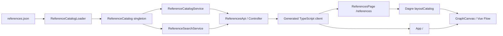
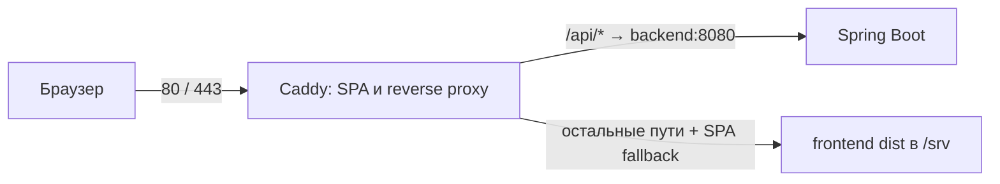

# Relationer — текущая архитектура

Состояние после завершения Дня 11, 10 ноября 2026. Документ описывает код
репозитория; не подтверждает доступность удалённого хостинга. Планы находятся
только в [roadmap](../roadmap.md), ранние предложения — в [архиве](../archive/README.md).

## Поток данных и компоненты

Данные каталога загружаются из classpath один раз при создании Spring singleton.
Невалидный каталог препятствует старту приложения. Read API и поиск используют
одни записи. Базы данных, авторизации, административных и write-endpoint нет.
Изменение JSON требует пересборки/перезапуска backend.

### Backend

Kotlin 1.9.25, JDK 21, Spring Boot 3.3.12, Gradle 8.10.2.
В `backend/src/main/kotlin/com/relationer/backend/`:

| Каталог/класс | Назначение |
| --- | --- |
| `domain/Person`, `PersonGraph` | Люди, направленные связи и выбранные A/B |
| `domain/ReferencePattern`, `ReferenceSource` | Эталон, категории, теги, вердикт и источник |
| `domain/ReferenceCatalogLoader` | JSON, проверка enum/ID/ссылок, восстановление графа |
| `domain/PathExtractor`, `PathEncoder`, `PathMatcher`, `ReferenceSearch` | Пути A/B и поиск |
| `api/ReferenceCatalog` | Один загруженный каталог |
| `api/ReferenceCatalogService` | DTO списка и полного кейса |
| `api/ReferenceSearchService`, `SearchApiMapper` | Запрос → PersonGraph → совпадения → DTO |
| `api/ReferenceSearchController` | Реализация трёх операций generated `ReferencesApi` |
| `api/SearchApiExceptionHandler` | Ошибки HTTP в формате `{message}` |

`backend/openapi.yaml` — единый wire-контракт. OpenAPI Generator 7.17.0
создаёт Kotlin API/DTO в `backend/build/generated/openapi`; `compileKotlin`
зависит от генерации. Generated-файлы не редактируются и не хранятся в Git.

### Frontend

Vue 3, TypeScript, Vite, Vue Flow 1.48.2, Dagre 3.1.3.

| Файл в `frontend/src/` | Назначение |
| --- | --- |
| `main.ts` | Выбор страницы по pathname: `/references` (также с завершающим `/`) или конструктор |
| `App.vue` | Конструктор, диалоги, выбранные люди/связи и результаты поиска |
| `domain/editor.ts` | EditorState, операции над графом, координаты и `toSearchRequest` |
| `composables/useReferenceSearch.ts` | Валидация, загрузка/ошибка, отмена, ревизия и устаревшие ответы |
| `pages/ReferencesPage.vue` | Метаданные, фильтры, порции деталей и infinite scroll |
| `domain/catalog.ts`, `catalogLabels.ts` | Фильтрация, nodes/edges и подписи |
| `domain/catalogLayout.ts` | Независимые от исходного графа координаты Dagre |
| `components/ReferenceCard.vue`, `ReferenceGraph.vue` | Метаданные, изображение, граф и его управление |
| `components/GraphCanvas.vue`, `PersonNode.vue` | Общий Vue Flow и карточки для конструктора/каталога |
| `components/SearchResults.vue` | Совпадения, источники и отдельные вердикты |
| `api/references.ts` | Адаптер generated-клиента |
| `api/generated/` | TypeScript Fetch API/DTO, генерируются из OpenAPI и исключены из Git |

Отдельной библиотеки маршрутизации нет. Ссылки между страницами выполняют обычную
навигацию; состояние конструктора живёт в памяти и не переносится между страницами.
Сохранение в localStorage/БД и загрузка эталона в конструктор отсутствуют.

`npm run api:generate` вызывает закреплённый JAR OpenAPI Generator, проверяя
SHA-256. Генерация выполняется перед dev, test, typecheck и build. Первый запуск
скачивает JAR из Maven Central; дальше используется локальный cache.

## references.json

Единственный production-источник — `backend/src/main/resources/references.json`.
Это обычный JSON-массив без комментариев и специальной группировки. Порядок
кровных кейсов, случаев свойства и духовных кейсов сохранён; ID стабильны.
JSON-fixtures под `src/test/resources` не являются источником runtime-каталога.

| Поле | Фактический формат и проверка загрузчика |
| --- | --- |
| `id` | Обязательная непустая строка, уникальна в каталоге |
| `categories` | Необязательный массив enum, преобразуется в Set; повторы исключаются, неизвестные значения отклоняются |
| `tags` | Необязательный массив непустых строк; trim, lowercase Locale.ROOT, NFC, Set |
| `description` | Необязательная непустая строка или null |
| `verdict` | Обязательный enum, независим от категорий и layout |
| `source` | Обязательный объект |
| `source.document` | Обязательная непустая строка в JSON-загрузчике |
| `source.page` | Необязательное положительное целое или null |
| `source.example`, `source.conclusion`, `source.image` | Необязательные непустые строки или null |
| `persons` | Массив объектов с уникальным непустым `id` и необязательным `name` |
| `relations` | Массив `{type, from, to}`; ссылки на существующих людей |
| `personA`, `personB` | ID разных людей из persons |

Если `categories`/`tags` отсутствуют, получается пустое множество. Явный `null`
вместо этих массивов не принимается. Отсутствующие описание/изображение становятся
null. Загрузчик не угадывает категорию: пустой набор отображается как
«Требует ручной классификации». Категория `MIXED` отсутствует.

### Категории, связи и вердикты

Категории эталона — несколько независимых признаков:

| Категория | Смысл |
| --- | --- |
| `BLOOD` | Кровные связи |
| `AFFINITY` | Свойство, связанное с браком |
| `SPIRITUAL` | Духовное родство |
| `ADOPTION` | Усыновление |

Категория не является типом ребра: граф/API используют `BIOLOGICAL`, `MARRIAGE`,
`SPIRITUAL`, `ADOPTION`. Биологические, духовные и приёмные связи направлены
от родителя/крёстного/усыновителя к ребёнку; брак при обходе симметричен.
Составной эталон может иметь `categories: ["BLOOD", "SPIRITUAL"]`, не становясь
одним видом `MIXED`. Категории описывают схему, а не автоматически вычисленный
вид отношения выбранной пары.

Вердикт источника хранится отдельно:
`FORBIDDEN` — «Запрещено», `ALLOWED` — «Разрешено»,
`UNDETERMINED` — «Не определено». Цветные badges переиспользуют палитру поиска.
Пустая выдача поиска не означает `ALLOWED` и не приравнивается к `UNDETERMINED`.

### Фактические данные

В production 11 случаев: 5 blood, 3 affinity-allowed, 3 spiritual-forbidden.
Все классифицированы; неоднозначность по сохранённым графам/описаниям не выявлена.
Смешанные категории: три случая `BLOOD + AFFINITY` и
`spiritual-forbidden-02` с `BLOOD + SPIRITUAL`. ADOPTION-кейсов, заполненных тегов
и `source.image` пока нет. Историческая сверка PDF не выполнена заново.
Точная классификация и страницы — в [отчёте каталога](../day11-catalog.md).

## HTTP API

Контракт: [backend/openapi.yaml](../../backend/openapi.yaml).

| Операция | Запрос/ответ |
| --- | --- |
| `GET /api/v1/references` | Полный массив `ReferenceSummaryDto`: id, categories, tags, verdict, description, source, hasImage; графов нет |
| `GET /api/v1/references/{id}` | `{metadata: ReferenceSummaryDto, graph: SearchRequest}`; неизвестный ID — 404 `{message}` |
| `POST /api/v1/references/search` | `SearchRequest` → `{matches: ReferenceMatchDto[]}`; неверный JSON/граф — 400 `{message}` |

На проводе категории и теги — JSON-массивы; generated TypeScript представляет
уникальные коллекции как `Set`. `SearchRequest` содержит только `persons`,
`relations`, `personA`, `personB`; координат и внутренних ID связей редактора нет.
`source` DTO содержит document, page, example, conclusion и optional image;
неизвестные сведения могут быть null. `hasImage` проверяет наличие значения
в каталоге, а не доступность файла. UI отдельно обрабатывает ошибку загрузки.

У API каталога нет серверных фильтров, пагинации или write-операций. Метаданные
и полные графы возвращаются из одного singleton. Поиск возвращает referenceId,
verdict, description, userPathCode, referencePathCode, source; категории/теги
доступны через каталог. Формат и семантика поиска описаны в
[действующей спецификации](../tree-matching-rules.md).

## Лента и визуализация

После GET списка frontend фильтрует все метаданные: категории по ИЛИ, теги по И,
вердикт и текст сочетаются с ними по И. Текст ищется по ID, описанию, документу
и примеру источника. Фильтр тегов появляется, когда в данных есть теги.

Для совпавших записей запрашиваются полные кейсы порциями до 10, затем сразу
рисуются раскрытые карточки. IntersectionObserver с запасом 500 px подгружает
следующую порцию; есть кнопка для ручной подгрузки. Смена фильтров отменяет
запросы, увеличивает ревизию, очищает карточки и прокручивает к началу.
Все графы сразу не запрашиваются; уже загруженные остаются в DOM — это не
виртуализированная лента. Есть загрузка, ошибка/повтор, пустая выдача и конец списка.

Dagre размещает ветви сверху вниз. Только BIOLOGICAL/ADOPTION задают смену
поколений; супруги и совместные родители выравниваются, если нет конфликта
с направлением предок → потомок. SPIRITUAL не задаёт новый уровень. Циклы
обрабатываются во вспомогательном графе; исходные данные не меняются. Это
эвристика, без гарантии отсутствия всех пересечений.

В каталоге карточки 132×52, в конструкторе 200×80. Сохраняются A/B, типы и
пунктир связей, масштабирование и fit-to-view. Высота холста учитывает уровни,
внутреннего скролла нет; крупный граф можно развернуть. ResizeObserver
переподгоняет масштаб при изменении контейнера. Кнопки каталога находятся
над холстом и не закрывают ветви на мобильном. [Подробности layout](../day11-layout.md).

`source.image` выводится рядом с графом на desktop и ниже на mobile, с lazy
loading и подписью при отсутствии/ошибке. Изображение должно быть доступно
по указанному пути/URL: автоматического извлечения или загрузки PDF нет.

## Docker Compose и сеть

`compose.yaml` собирает два runtime-сервиса: backend и caddy. У backend нет
публикации порта на хост; сеть Compose позволяет Caddy обращаться по имени
`backend:8080`. Наружу опубликованы TCP 80/443. Caddy сохраняет префикс `/api`,
а `try_files {path} /index.html` обеспечивает прямое открытие `/references`.

`backend/Dockerfile` собирает bootJar на Gradle/JDK 21, runtime — Temurin JRE 21.
`caddy/Dockerfile` собирает frontend с Node 22.12 и JRE 21 для OpenAPI, затем
копирует dist в Caddy 2.10. Отдельного `frontend/Dockerfile` нет.
`DOMAIN` берётся из `.env`: `:80` для локального HTTP, домен для HTTPS.
Volumes `caddy_data`/`caddy_config` сохраняют состояние Caddy; это не БД приложения.

`compose.prod.yaml` использует готовые образы `relationer_be_backend:latest`
и `relationer_be_caddy:latest` и не содержит build-секций. Их нужно заранее
доставить на хост. Сам файл не публикует образы и не выполняет CI/CD.
Команды обоих вариантов — в [руководстве развёртывания](../deployment.md).

Без Docker Vite слушает 127.0.0.1:5173 и проксирует `/api` на 8080.
`API_PROXY_TARGET` меняет dev-target, `VITE_API_BASE_URL` — адрес API в browser bundle;
по умолчанию он пустой для same-origin. CORS между разными origin в backend
отдельно не настроен. `vite preview` сам по себе не заменяет Caddy.
